# TrackFlow: Multi-Cloud Ticket Management System

A Jira-style ticket tracker (React, Spring Boot, MySQL) that ran **on AWS and Azure at the same time**: four Kubernetes clusters in four regions behind **one URL with automatic DNS failover**, built entirely from code with OpenTofu and GitHub Actions. An admin can create a new environment from a **one-click Deployment Portal** that drives a real provisioning pipeline and shows every step live.

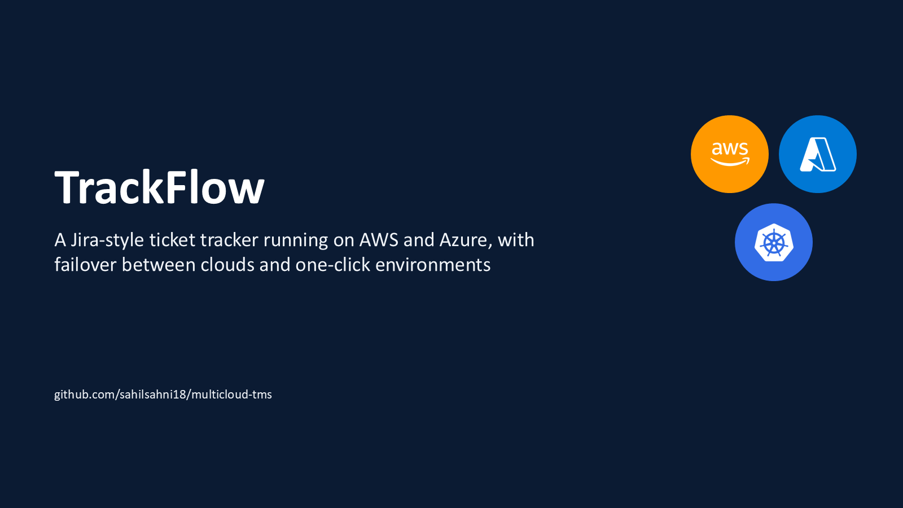

[](https://github.com/Chetansahney/multicloud-tms/actions/workflows/backend-ci.yml)
[](https://github.com/Chetansahney/multicloud-tms/actions/workflows/frontend-ci.yml)
[](https://github.com/Chetansahney/multicloud-tms/actions/workflows/k8s-ci.yml)
[](https://github.com/Chetansahney/multicloud-tms/actions/workflows/infra-ci.yml)

---

## Contents

1. [Results](#results)
2. [Architecture](#architecture)
3. [The application](#the-application)
4. [Security](#security)
5. [Infrastructure as code](#infrastructure-as-code)
6. [CI/CD](#cicd)
7. [One-click Deployment Portal](#one-click-deployment-portal)
8. [Failover](#failover)
9. [Engineering decisions](#engineering-decisions-where-reality-changed-the-plan)
10. [Cost and operations](#cost-and-operations)
11. [Tech stack](#tech-stack)
12. [Repository layout](#repository-layout)
13. [Run it locally](#run-it-locally)
14. [Run it in the cloud](#run-it-in-the-cloud)
15. [Configuration](#configuration)
16. [Delivery timeline](#delivery-timeline)
17. [Docs and presentation](#docs-and-presentation)

---

## Results

All numbers below were measured on the live system in October 2026.

| Metric | Result | Target |
|---|---|---|
| Kubernetes clusters | **4** (2 × AWS EKS, 2 × Azure AKS) in 4 regions | 2 clouds, 2 regions each |
| Regional failover, AWS us-east-1 to us-west-2 | **38 s** | under 2 min |
| Cross-cloud failover, both AWS regions down, Azure serves | **45 s** | under 2 min |
| Backend line coverage | **93%** (98 backend tests, 19 frontend tests) | 70% |
| REST API | **48 endpoints**, all in Swagger | |
| Portal click to a live, isolated environment | **about 3 min** | no manual steps |
| Cloud credentials stored anywhere | **0** (GitHub OIDC) | |
| From empty accounts to the full system | **about 40 min** (one apply, one deploy) | |

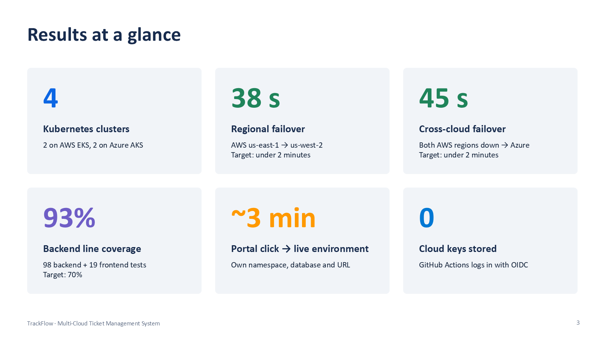

---

## Architecture

Users only ever see one address. Azure Traffic Manager health-checks all four clusters and sends traffic to the highest-priority healthy one.

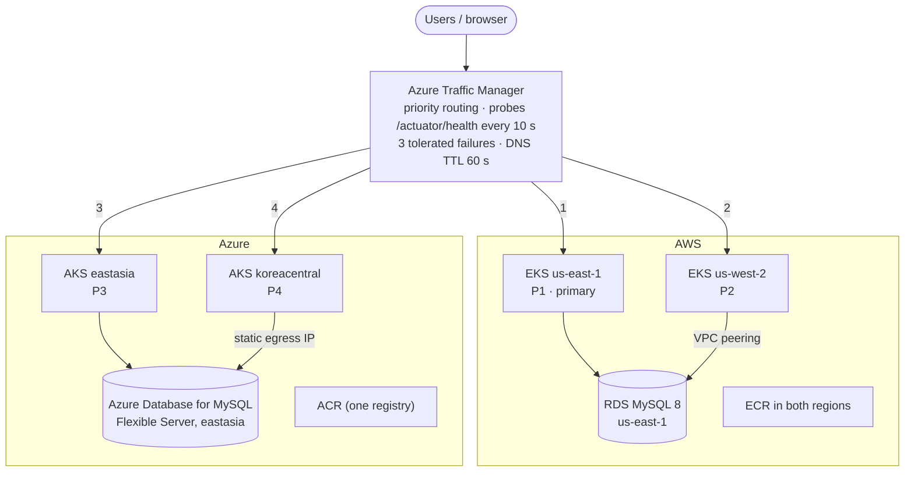

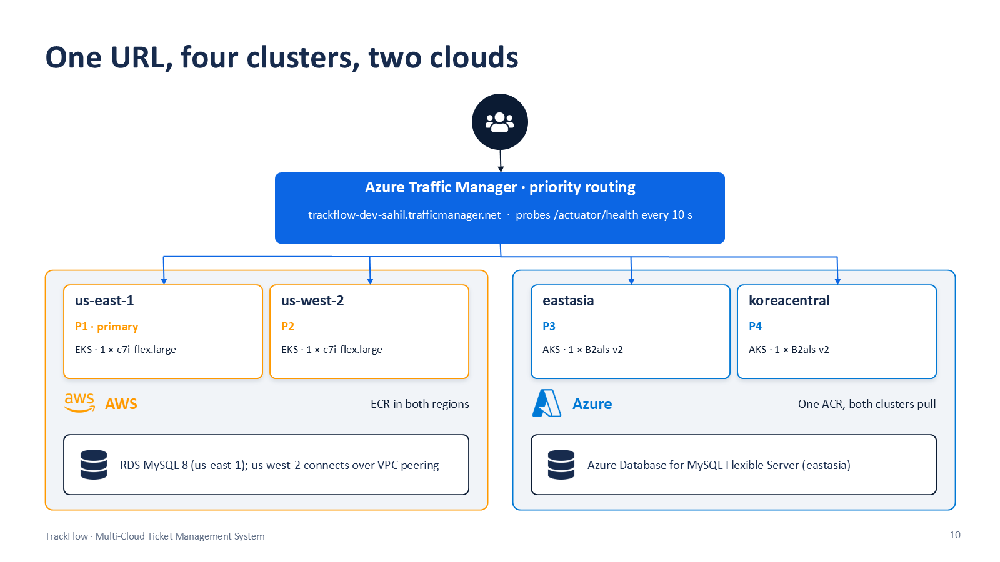

**How the data works.** Each cloud has one writer database. The two AWS clusters share the RDS instance (us-west-2 reaches it over VPC peering) and the two Azure clusters share the Azure MySQL server. Failing over inside AWS keeps all data and sessions. Failing over to Azure is disaster recovery: Azure serves the app with its own data, which matches the scope of the original design (cross-cloud replication was out of scope).

### Inside every cluster

Every cluster runs exactly the same images and manifests. The only differences between kind, EKS and AKS are a Kustomize overlay and the values the pipeline fills in.

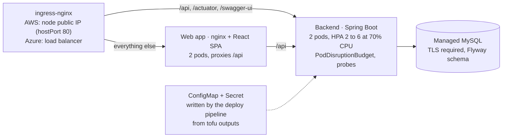

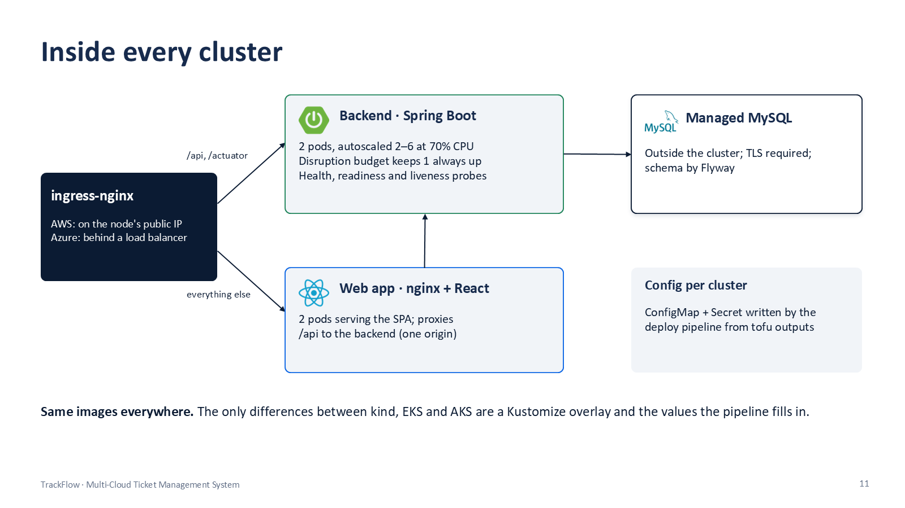

---

## The application

### Four roles, enforced in the API and in the UI

| Role | Persona | Can do |
|---|---|---|
| **ADMIN** | Platform admin | Users and roles, every project and ticket, Deployment Portal |
| **PROJECT_MANAGER** | Delivery lead | Own projects and members, assign, close and reopen tickets, reports, team metrics |
| **DEVELOPER** | Engineer | Tickets assigned to them, move status on the board, comment |
| **USER** | Requester | Raise tickets, follow their own tickets, reopen their own within 14 days |

`@PreAuthorize` guards every controller method, row-level rules ("own ticket", "assigned to me", "member of project") live in one unit-tested `TicketAccessPolicy`, and the React menus and routes are built from one role map (`frontend/src/app/navigation.ts`). A forbidden call returns 403.

### A ticket workflow the API actually enforces

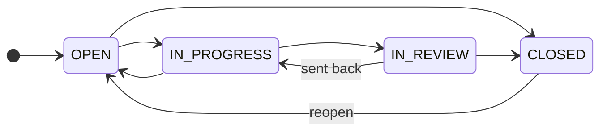

Illegal moves are rejected with **409 Conflict**, and optimistic locking (`@Version`) stops two editors from overwriting each other. Every create, assignment, field change and status change is written to `ticket_history` and `activity_logs`, and the ticket page shows a merged timeline of comments and history.

### Features

- **Kanban board** per project: drag a card to another column to change its status.
- **Search and filters** by project, status, priority and assignee, with text search, paging and sorting.
- **Dashboard** with totals, charts by status and priority, and team productivity.
- **Reports** with CSV export of the filtered ticket list.
- **Comments** (edit your own, soft delete) and a full change history.
- **Admin**: users (create, activate, assign roles, reset passwords), roles, and the Deployment Portal with its history.
- **Profile**: edit your name, change your password.

### API

48 endpoints under `/api/v1`, documented with OpenAPI at `/swagger-ui.html` and in [docs/api/api-reference.md](docs/api/api-reference.md). Errors use RFC 7807 problem+json.

| Area | Endpoints |
|---|---|
| Auth | register, login, refresh, logout, me |
| Users and roles | CRUD, lookup, roles, password reset, own profile and password |
| Projects | CRUD, members |
| Tickets | CRUD, by key, assignee, transitions, history, timeline, CSV export |
| Comments | list, add, edit, delete |
| Dashboard | dashboard, activity |
| Deployments | options, create, history, detail, live stream (SSE), destroy, signed pipeline callback |
| Ops | `/actuator/health` (liveness, readiness), `/actuator/prometheus` |

### Database

13 tables created by Flyway (`V1__init_schema.sql`): `roles, users, user_roles, refresh_tokens, projects, project_members, tickets, comments, attachments, ticket_history, activity_logs, deployments, deployment_events`. Every table has audit fields, foreign keys and indexes on its filter columns. Demo data (`V1_1__demo_seed.sql`) loads only with the `demo-data` profile. See the [ER diagram](docs/database/er-diagram.md).

---

## Security

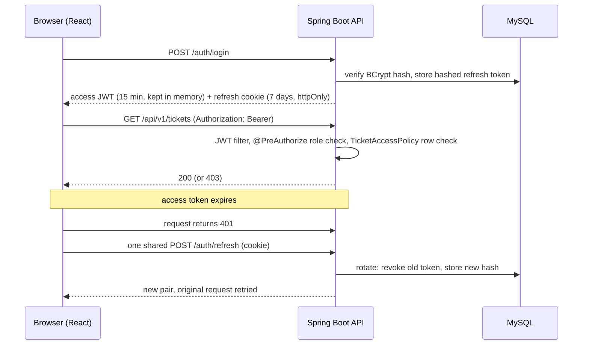

- **Passwords**: BCrypt, cost 12. **Tokens**: HS512-signed JWTs. Refresh tokens rotate on every use and are stored hashed; logout revokes them.
- **Rate limiting**: login, register and refresh are limited to 10 requests per minute per IP (Bucket4j).
- **Containers**: non-root, read-only root filesystem, all Linux capabilities dropped; namespaces enforce Kubernetes "restricted" Pod Security.
- **Supply chain**: a Trivy image scan fails CI on any CRITICAL vulnerability.
- **Cloud access**: GitHub Actions proves its identity to AWS (IAM role) and Azure (federated credential) through **OIDC** on every run. There are no cloud keys in the repository, in GitHub secrets or in the app.
- **Pipeline callbacks**: the provisioning workflow signs each step report with **HMAC-SHA256** over `timestamp.body`; the backend compares in constant time and rejects anything older than 5 minutes.

More detail: [docs/architecture/security-flow.md](docs/architecture/security-flow.md).

---

## Infrastructure as code

Everything in the cloud is created by OpenTofu (Terraform-compatible) from `infra/`. Nothing is clicked in a console.

| Layer | What it creates |
|---|---|
| `infra/bootstrap` (once, from a laptop) | S3 state bucket, Azure state storage account, AWS IAM role and Azure app registration trusted by this repository through GitHub OIDC |
| `infra/modules/aws` | `vpc`, `eks`, `ecr`, `rds`, `frontend` (S3 + CloudFront), `route53` |
| `infra/modules/azure` | `aks`, `acr`, `mysql`, `traffic-manager`, `static-web-app` |
| `infra/envs/dev/aws` | us-east-1 and us-west-2: peered VPCs, an EKS cluster per region, ECR in both, one RDS (about 63 resources) |
| `infra/envs/dev/azure` | eastasia and koreacentral: AKS in both, ACR, MySQL Flexible Server, Traffic Manager, Static Web Apps (about 17 resources) |

`cluster_count` (1 to 5) is a `for_each` over clusters. Features that new free cloud accounts do not allow are **flags, not separate code**: `enable_replicas` (cross-region RDS replica), `enable_cloudfront` (HTTPS through CloudFront) and `domain_name` (Route 53). Details: [infra/README.md](infra/README.md).

---

## CI/CD

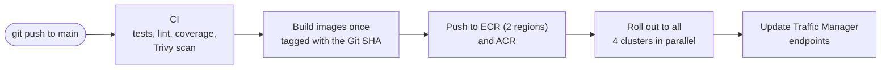

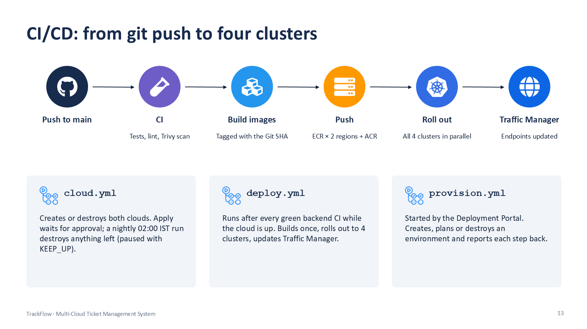

| Workflow | Trigger | What it does |
|---|---|---|
| `backend-ci.yml` | push / PR on `backend/` | Build, unit and integration tests (Testcontainers), coverage, image build, Trivy |
| `frontend-ci.yml` | push / PR on `frontend/` | ESLint, Vitest, type-check and build, image build, Trivy, push to GHCR |
| `k8s-ci.yml` | push / PR on `k8s/` | Renders every Kustomize overlay and validates it with kubeconform |
| `infra-ci.yml` | push / PR on `infra/` | `tofu fmt -check` and `tofu validate` on every stack |
| `cloud.yml` | manual: plan / apply / destroy · nightly destroy at 02:00 IST | Creates or destroys both clouds. **Apply waits for a human approval** in the `cloud` environment. The nightly run destroys anything left running unless `KEEP_UP=true`. |
| `deploy.yml` | manual, or after a green Backend CI while `CLOUD_UP=true` | Builds images once, pushes to all registries, rolls out to all 4 clusters, points Traffic Manager at each cluster |
| `provision.yml` | started by the Deployment Portal | Plans, creates or destroys one portal environment and reports every step back |

---

## One-click Deployment Portal

An admin picks a cloud, region, cluster count and environment and clicks **Deploy**. The backend never touches the cloud itself: it records the request and asks GitHub to start a workflow, which does the work with the OIDC cloud logins GitHub already has.

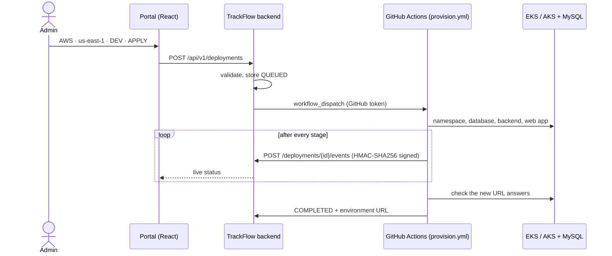

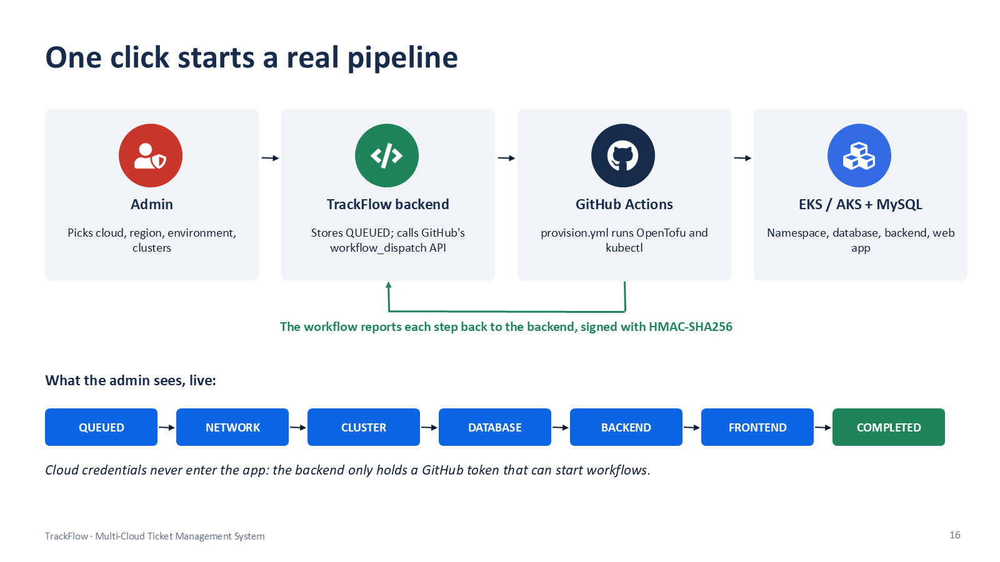

Live steps: `QUEUED → NETWORK_CREATED → CLUSTER_CREATED → DATABASE_CREATED → BACKEND_DEPLOYED → FRONTEND_DEPLOYED → COMPLETED`, with `FAILED` possible at any step (the message names the step and links to the pipeline run) and `DESTROYING → DESTROYED` for teardown.

| Action | What really happens | Time | Tested live |
|---|---|---|---|
| **APPLY** (Dev) | A new, isolated environment on the region's cluster: its own namespace with restricted pod security, its own database on the cloud's MySQL server (created by a Kubernetes Job because the database is private), backend and web app, and its own URL `http://dev<id>-tms.<ip>.nip.io`. The workflow checks that the URL answers before it reports COMPLETED. | about 3 min | ✅ deployment #2 COMPLETED, URL live, health UP |
| **PLAN** (QA, Prod) | A real `tofu plan` of the full stack for that environment and region, from an empty local state. Nothing is created. | 2 to 3 min | ✅ Azure Prod: 20 resources, including 2 AKS clusters, MySQL, ACR, Traffic Manager |
| **DESTROY** | Drops the environment's database and deletes its namespace. | about 1 min | ✅ deployment #1 cleaned up |

Guard rails: only ADMIN can deploy, QA and Prod are plan-only, Prod needs the environment name typed as confirmation, and only one deployment can run per cloud, region and environment at a time.

**Why environments and not brand-new clusters**: a new EKS or AKS cluster plus a database takes 20+ minutes, exceeds the quotas of new accounts and costs credits. The full-stack path is exactly what PLAN shows and what `cloud.yml` already proves.

**A bug found by the live test**: the first environment's hostname was `tms-dev-1.<ip>.nip.io`, and nip.io read the trailing `1` as the first octet of the IP. The environment itself was healthy, the portal correctly reported `FAILED at step 'frontend'` with a link to the log, and the fix (hostnames that end in letters, `dev1-tms.<ip>.nip.io`) was verified by the next deployment.

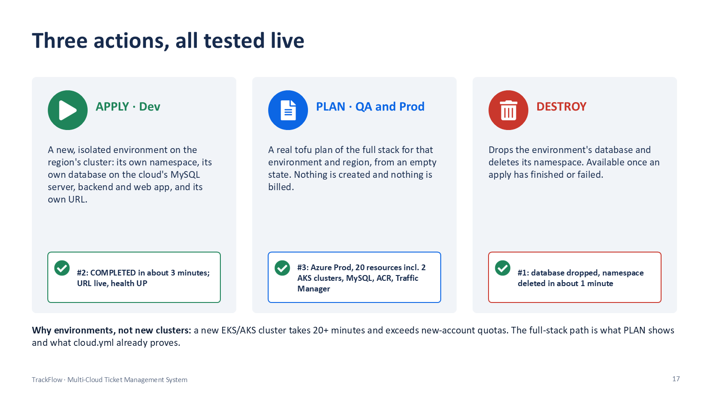

---

## Failover

Traffic Manager probes `/actuator/health` on all four clusters every 10 s. After 3 failed probes a cluster is marked Degraded and DNS (TTL 60 s) answers with the next healthy priority: **P1 us-east-1, P2 us-west-2, P3 eastasia, P4 koreacentral**. When the primary recovers, traffic returns to it automatically.

| Test (10 Oct 2026) | Method | Result |
|---|---|---|
| Lose AWS us-east-1 | scale its backend to 0 | us-west-2 serving in **38 s** |
| Lose both AWS regions | scale both backends to 0 | Azure serving in **45 s**, login works |
| Restore | scale back to 2 | traffic back on us-east-1 |

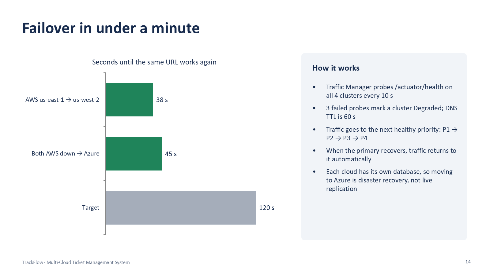

---

## Engineering decisions: where reality changed the plan

The original plan assumed paid cloud accounts. New free and student accounts block several services, so each blocked feature became a flag and the design goal (two clouds, regional failover, one URL, everything as code) was kept.

| Original plan | What was built | Why |
|---|---|---|
| Azure East US + West Europe | Azure East Asia + Korea Central | The Azure for Students subscription allows only five regions; East Asia is the only one of them with Static Web Apps |
| Route 53 global entry in front of Traffic Manager | Traffic Manager across all four clusters | One global failover URL without buying a domain; the AWS Free plan also blocks Route 53 failover records |
| Load balancer ingress on EKS; SPA on S3 + CloudFront | ingress-nginx on the node's public IP; the SPA runs in every cluster | New AWS accounts cannot create load balancers or CloudFront distributions until AWS Support enables them (`enable_cloudfront` flag) |
| Cross-region read replicas | One database per cloud; us-west-2 over VPC peering | Replicas are not allowed on free plans (`enable_replicas` flag) |
| Portal creates new clusters | Portal creates isolated environments; PLAN shows the full stack | New clusters take 20+ min and exceed quotas |
| 7 days, 12 steps | 3 days, 9 steps, cloud last | Everything proven locally before spending credits |

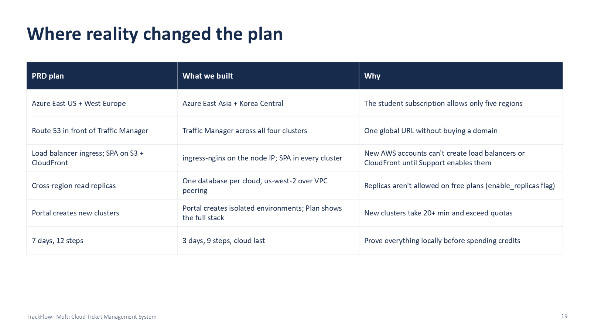

---

## Cost and operations

| Item | Value |
|---|---|
| Running cost of the full system | about **$1.45/hour** (AWS about $1.33, Azure about $0.12), paid from free credits, $0 out of pocket |
| Spend during the project | AWS $12.56 by 13 Oct (EKS $9.94, RDS $1.43, EC2 $1.09); Azure about ₹192 |
| Safety net | nightly destroy at 02:00 IST; `KEEP_UP=true` pauses it for reviews |
| Teardown check | after every destroy, both accounts were checked directly for leftover clusters, servers, disks, IPs, NAT gateways and load balancers |

**Lesson learned**: most of the AWS cost was the two EKS control planes. Kubernetes 1.33 moved to EKS extended support on 29 July 2026, which bills $0.60 per cluster per hour instead of $0.10. Setting `kubernetes_version = "1.34"` before an apply brings AWS down to about $0.35/hour.

The cloud environment has been destroyed; the state storage and OIDC trust are kept so it can be rebuilt in about 40 minutes.

---

## Tech stack

| Layer | Choice |
|---|---|
| Frontend | React 19, TypeScript 5.9, Vite 7, React Router, Redux Toolkit + RTK Query, Axios, MUI 7 (Atlassian-like styling) |
| Backend | Java 21, Spring Boot 3.5, Spring Security, Spring Data JPA, jjwt, MapStruct, Flyway, springdoc-openapi, Bucket4j |
| Database | MySQL 8: Docker locally, Amazon RDS, Azure Database for MySQL Flexible Server |
| Containers | Docker multi-stage builds; nginx-unprivileged for the SPA |
| Orchestration | Kubernetes 1.33: kind locally, EKS, AKS; Kustomize overlays |
| Infrastructure as code | OpenTofu 1.10; remote state in S3 and Azure Storage |
| CI/CD | GitHub Actions with OIDC; Trivy |
| Testing | JUnit 5, Mockito, Testcontainers (real MySQL), Vitest + Testing Library, ESLint |

---

## Repository layout

```
.
├── backend/                Spring Boot 3.5 (Java 21, Maven wrapper)
│   ├── src/main/java/com/trackflow/tms/
│   │   ├── controller/     REST endpoints (@PreAuthorize on every method)
│   │   ├── service/        business logic, TicketAccessPolicy, workflow, dashboard
│   │   │   └── provisioning/   portal runners: GitHub Actions (cloud), simulated (local)
│   │   ├── repository/     Spring Data JPA
│   │   ├── entity/         JPA entities and enums
│   │   ├── dto/  mapper/   API shapes
│   │   ├── security/       JWT, filters, rate limit, callback HMAC
│   │   └── config/ exception/ util/
│   └── src/main/resources/db/
│       ├── migration/      Flyway schema (all environments)
│       └── demo/           Flyway demo seed (local, dev and QA only)
├── frontend/               React 19, TypeScript, Vite
│   └── src/
│       ├── api/            axios client (silent refresh), RTK Query endpoints, DTO types
│       ├── app/            store, hooks, role-based navigation map
│       ├── features/auth/  login, register, session, route guards
│       ├── pages/          dashboard, board, tickets, projects, reports, admin, profile, settings
│       └── components/     layout, labels, dialogs, pickers
├── k8s/
│   ├── base/ frontend/     Deployments, Services, ConfigMap, HPA, PDB, Ingress
│   └── overlays/           local (kind), cloud (EKS/AKS), portal (one portal environment)
├── infra/                  OpenTofu: bootstrap, modules/aws, modules/azure, envs/dev
├── .github/workflows/      CI, cloud lifecycle, deploy, portal provisioning
├── scripts/                kind setup, signed portal callback, in-cluster SQL helper
├── docs/                   API reference, ER diagram, security flow, images, presentation
└── docker-compose.yml      local stack
```

---

## Run it locally

Requires Docker Desktop and JDK 21 (Maven comes with the wrapper), and Node 20+ for the frontend.

**Option 1: everything in Docker**

```bash
docker compose up -d --build
```

The web app is on http://localhost:3000 and the API on http://localhost:8080 (Swagger at `/swagger-ui.html`).

**Option 2: backend and frontend in dev mode**

```bash
docker compose up -d mysql
cd backend
./mvnw spring-boot:run          # Windows: mvnw.cmd spring-boot:run
```

```bash
cd frontend
npm install
npm run dev                     # http://localhost:5173, proxies /api to localhost:8080
```

The backend runs Flyway on start-up (schema and demo data in the `local` profile). MySQL listens on `localhost:3306`, database `trackflow`, user `trackflow` / `trackflow_local` (override in `.env`, see `.env.example`). To point the dev server at another backend port: `VITE_PROXY_TARGET=http://localhost:8081 npm run dev`.

**Option 3: on Kubernetes (kind)**

```bash
./scripts/kind-up.sh            # Windows: scripts/kind-up.ps1 · app on http://localhost:8088
```

**Demo accounts** (password `Password@123`):

| Email | Role |
|---|---|
| admin@trackflow.dev | ADMIN |
| pm@trackflow.dev | PROJECT_MANAGER |
| dev@trackflow.dev, dev2@trackflow.dev | DEVELOPER |
| user@trackflow.dev | USER |

**Tests**

```bash
cd backend
./mvnw verify                   # unit and integration tests; Testcontainers starts its own MySQL
                                # coverage report: backend/target/site/jacoco/index.html
cd frontend
npm run lint && npm test        # ESLint, Vitest / Testing Library
npm run build                   # type-check and production bundle
```

---

## Run it in the cloud

1. **Bootstrap once** (`infra/bootstrap`, from a laptop): state storage and the OIDC trust for this repository. Save its outputs as repository variables (`AWS_ROLE_ARN`, `AZURE_CLIENT_ID`, `AZURE_TENANT_ID`, `AZURE_SUBSCRIPTION_ID`, `TF_STATE_BUCKET`, `AZ_STATE_RG`, `AZ_STATE_SA`, `TM_DNS_NAME`).
2. **Create both clouds**: Actions → *Cloud infrastructure* → `apply`, `both`, then approve the `cloud` environment (about 25 min).
3. **Deploy**: Actions → *Deploy to cloud* (about 15 min). The app is then on `http://<TM_DNS_NAME>.trafficmanager.net`.
4. **Portal on real GitHub Actions** (optional): add the repository secrets `DEPLOY_CALLBACK_SECRET` (random, `openssl rand -hex 32`) and `DEPLOY_GITHUB_TOKEN` (fine-grained token, this repository only, Actions read/write), then deploy again.
5. **Destroy** when done: *Cloud infrastructure* → `destroy`, `both` (about 20 min). The nightly run destroys anything left over.

Full guide: [infra/README.md](infra/README.md).

---

## Configuration

| Env var | Default | Notes |
|---|---|---|
| `SPRING_PROFILES_ACTIVE` | none | `local` on a laptop, `cloud` on EKS/AKS (plus `demo-data` for seeded accounts) |
| `DB_URL`, `DB_USERNAME`, `DB_PASSWORD` | localhost / trackflow | |
| `JWT_SECRET` | dev key in `local` only | Base64, at least 64 bytes: `openssl rand -base64 64` |
| `CORS_ALLOWED_ORIGINS` | `http://localhost:5173` in `local` | Comma-separated frontend origins |
| `REFRESH_COOKIE_SECURE`, `REFRESH_COOKIE_SAME_SITE` | `true`, `Strict` | |
| `BOOTSTRAP_ADMIN_EMAIL`, `BOOTSTRAP_ADMIN_PASSWORD` | unset | Creates the first admin where there is no demo data |
| `AUTH_RATE_LIMIT_PER_MINUTE` | 10 | Login, register and refresh per IP |
| `DEPLOY_RUNNER` | `SIMULATED` | `GITHUB_ACTIONS` in the cloud (set by `deploy.yml` when the portal secrets exist) |
| `DEPLOY_GITHUB_TOKEN` | unset | Lets the portal start `provision.yml` |
| `DEPLOY_CALLBACK_URL` | unset | Public URL of the backend the workflow reports to |
| `DEPLOY_CALLBACK_SECRET` | unset | HMAC key shared with the provisioning workflow; unset disables callbacks |
| `DEPLOY_GITHUB_REPOSITORY`, `DEPLOY_GITHUB_WORKFLOW`, `DEPLOY_GITHUB_REF` | this repository, `provision.yml`, `main` | |
| `DEPLOY_APPLY_ENVIRONMENTS` | `DEV` | Environments allowed to APPLY; the others are plan-only |
| `DEPLOY_SIMULATED_STEP_DELAY` | `3s` | Pause between simulated portal steps |

---

## Delivery timeline

Everything was built and proven locally first; the cloud was touched only at the end.

| Step | Deliverable | Exit check | Status |
|---|---|---|---|
| 1 | Repository scaffold, MySQL schema (Flyway), ER diagram | Migrations apply clean on MySQL 8 | ✅ |
| 2 | Spring Boot skeleton and JWT security (register, login, refresh rotation, logout, roles) | Auth integration tests pass (Testcontainers) | ✅ |
| 3 | Domain APIs: users, projects, tickets (workflow, access policy), comments, history, search, dashboard, deployments | Every endpoint in Swagger; service tests green | ✅ |
| 4 | React shell: login, silent token refresh, protected routes, role-based sidebar | Each role sees the right menu | ✅ |
| 5 | Pages: dashboard, board, projects, tickets, users and roles, profile, reports, settings, Deployment Portal | Full ticket lifecycle from the UI | ✅ |
| 6 | Dockerfiles, Compose stack, Kustomize on kind, GitHub Actions CI | `docker compose up` works; app runs on kind; CI green | ✅ |
| 7 | OpenTofu modules for AWS and Azure | `tofu plan` clean for both clouds | ✅ |
| 8 | Both clouds live, CD to 4 clusters, Traffic Manager failover | A lost region fails over in under 2 min | ✅ 38 s and 45 s |
| 9 | Portal on real GitHub Actions, demo, destroy | A portal deploy lands as COMPLETED | ✅ about 3 min |

---

## Docs and presentation

- [API reference](docs/api/api-reference.md) (interactive at `/swagger-ui.html`)
- [Database design and ER diagram](docs/database/er-diagram.md)
- [Security flow](docs/architecture/security-flow.md)
- [Infrastructure guide](infra/README.md)
- [Project presentation](docs/presentation/TrackFlow-Final-Demo.pptx) (22 slides with speaker notes)

## License

[MIT](LICENSE) © 2026 Chetan Sahney
