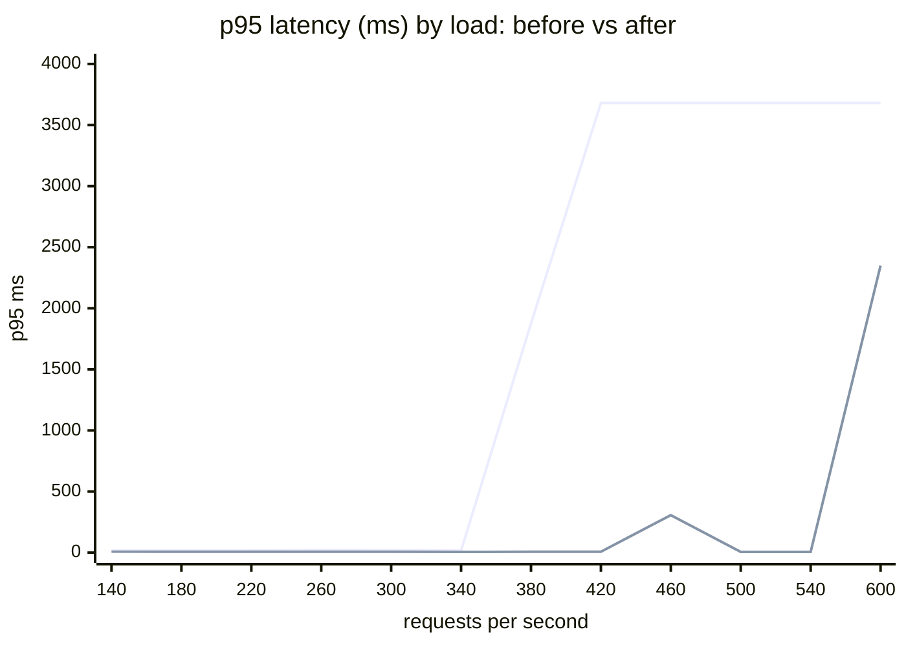

# Load test report: failure point raised by 58%

**Result:** on the same hardware, the same data and the same traffic, the backend's failure point went from **380 req/s to 600 req/s (+58%)**, and the highest load it serves within the latency target went from **340 req/s to 540 req/s (+59%)**. At the old failure load, p95 latency dropped from 1.9 s to 7 ms.

| | Before | After | Change |
|---|---|---|---|
| Last healthy load (p95 < 500 ms, no errors, nothing dropped) | 340 req/s | **540 req/s** | **+59%** |
| Failure point (first load that misses the target) | 380 req/s | **600 req/s** | **+58%** |
| Maximum throughput reached | 376 req/s | 555 req/s | +48% |
| p95 latency at 340 req/s | 17 ms | 6 ms | 2.8× faster |
| p95 latency at 380 req/s | 1,876 ms | 7 ms | |
| Server errors at any step | 0 | 0 | |

## 1. Test setup

**System under test:** one backend pod, built from the production image (`backend/Dockerfile`), with the resources of a cloud pod.

| Component | Setting |
|---|---|
| Backend | Spring Boot image, **1 vCPU, 768 MiB** (the pod's memory limit in `k8s/base`), profile `cloud,demo-data`, connection pool 10 |
| Database | MySQL 8.4, **2 vCPU, 1 GiB** (comparable to the RDS `db.t4g.micro` used in the cloud), TLS required |
| Data | demo seed plus [`loadtest/seed.sql`](../../loadtest/seed.sql): **3,011 tickets, 9,006 comments**, history rows |
| Load generator | [k6](https://k6.io) 1.3, [`loadtest/trackflow.js`](../../loadtest/trackflow.js), on the same machine but outside the resource limits |

**Traffic mix** (one API request per iteration, weighted like real use): 35% ticket list (random page, half of them filtered by status and priority), 20% ticket detail, 15% ticket timeline (comments and history), 10% dashboard, 10% projects, 5% text search, 5% new comment (writes). Four users with different roles (admin, project manager, developer, user) log in once and reuse their tokens. 403 and 404 answers for tickets a role may not see are expected and are not counted as errors.

**Method** ([`loadtest/run.sh`](../../loadtest/run.sh)):
1. Fresh database, seed, 30 s warm-up.
2. A ladder of constant arrival rates (100, 140, 180 ... 600 req/s), **60 s per step**, 20 s pause between steps.
3. **Failure** = p95 above 500 ms, or 1% or more server errors, or any request dropped because the server could not keep up. The run stops after two failing steps in a row.
4. Both versions ran the **identical ladder** on a fresh database with no other workloads on the machine.

## 2. Baseline: where and why it failed

| Load (req/s) | 100 | 140 | 180 | 220 | 260 | 300 | **340** | **380** | 420 |
|---|---|---|---|---|---|---|---|---|---|
| Served (req/s) | 98 | 138 | 177 | 217 | 255 | 295 | 335 | 362 | 376 |
| p95 (ms) | 75 | 17 | 17 | 18 | 22 | 21 | **17** | **1,876** | 3,680 |
| p99 (ms) | 172 | 24 | 23 | 26 | 43 | 44 | 26 | 2,062 | 3,842 |
| Dropped | 0 | 0 | 0 | 0 | 0 | 0 | 0 | **119** | 870 |

Latency is flat up to 340 req/s and then falls off a cliff: a resource is saturated and requests start queueing. The first step is slower in both runs because the JVM is still compiling.

**Profiling.** At load we compared server time per endpoint (Spring Boot `/actuator/prometheus`) and SQL statements per query shape (MySQL `performance_schema`). Under load the backend used up to 93% of its CPU and MySQL up to 175% of its two CPUs. Database time per minute broke down as follows:

| Source | Database time per minute | Cause |
|---|---|---|
| Ticket list + page count | ~100 s | Loaded full `Ticket`, `Project` and two `User` entities per row (description text, password hashes, ...) to show 14 fields; every row tracked for dirty checking |
| Dashboard | ~70 s | **7 separate aggregate queries** over all visible tickets on every view (3 GROUP BYs and 4 counts), plus productivity and activity queries |
| `SET autocommit` + `COMMIT` | ~37 s | ~44,000 `SET autocommit` statements per minute: two extra round trips around every transaction |
| Project list stats | ~28 s | Ticket counts per project on every call |

## 3. What was changed

| # | Change | Where | Effect |
|---|---|---|---|
| 1 | **Ticket list as a projection**: one Criteria query selects only the 14 columns a list row shows and maps them straight to the response record; the page count query only runs when the page does not already reveal the total | [`repository/TicketSummaryQuery.java`](../../backend/src/main/java/com/trackflow/tms/repository/TicketSummaryQuery.java), `TicketService.search` | No entity hydration or dirty checking, narrower rows to sort and send |
| 2 | **Dashboard in one aggregate query**: status, priority and type breakdowns and the four headline counts come from a single `GROUP BY status, priority, type` with conditional sums (at most 48 rows), folded in Java | `DashboardService.aggregate` | 7 queries become 1 |
| 3 | **No autocommit toggling**: connections start with autocommit off (`spring.datasource.hikari.auto-commit=false`) and Hibernate is told so (`hibernate.connection.provider_disables_autocommit=true`) | `application.yml` | Two fewer statements per request. Safe because every database call runs inside a Spring transaction; the test helper that writes directly with `JdbcTemplate` now uses autocommit connections |
| 4 | **15-second dashboard cache per viewer** (Caffeine, `@Cacheable`, key = user, project, weeks) | `DashboardService`, `application.yml` (`spring.cache`) | Repeated dashboard views within 15 s cost nothing. Dashboard numbers are summaries, so this staleness is not visible to users. Disabled in tests, which check numbers right after changing data |

All 171 backend tests pass with these changes; the API responses are unchanged.

**Tried and rejected:** MySQL Connector/J tuning (`useServerPrepStmts`, `cachePrepStmts`, `readOnlyPropagatesToServer`, `useLocalSessionState`, `elideSetAutoCommits`, ...). With these settings the backend stalled at about 175 req/s with idle CPU, so they were removed.

## 4. Result after the changes

| Load (req/s) | 100 | 140 | 180 | 220 | 260 | 300 | 340 | 380 | 420 | 460 | 500 | **540** | **600** |
|---|---|---|---|---|---|---|---|---|---|---|---|---|---|
| Served (req/s) | 98 | 138 | 178 | 217 | 256 | 296 | 335 | 374 | 414 | 453 | 493 | 532 | 555 |
| p95 (ms) | 17 | 8 | 7 | 7 | 7 | 7 | 6 | 7 | 7 | 307 | 6 | **6** | **2,349** |
| p99 (ms) | 65 | 12 | 9 | 9 | 9 | 14 | 9 | 9 | 9 | 539 | 9 | 9 | 2,578 |
| Dropped | 0 | 0 | 0 | 0 | 0 | 0 | 0 | 0 | 0 | 0 | 0 | 0 | **788** |

The 460 req/s step shows a temporary latency spike (p95 307 ms, still within the target) that does not repeat at 500 and 540 req/s, most likely a garbage-collection pause. The run fails at 600 req/s, where the single vCPU is saturated.


*First line: before (the run stopped after 420 req/s; later points repeat the last value). Second line: after.*

## 5. Limits of this test

- **One pod, local replica.** The numbers describe one backend pod with 1 vCPU, not the whole cloud deployment (which runs 2 to 6 pods per cluster behind an autoscaler, in 4 clusters). The comparison is valid because both versions ran on the same machine, limits, data and ladder.
- **Dashboard cache hit rate.** The test has four users, so the dashboard cache is hit on most views. With many users each opening the dashboard rarely, the cache helps less; the single aggregate query (change 2) still applies to every view.
- **Earlier runs discarded.** First runs were taken while other containers (a local kind cluster and a restarting Compose stack) shared the machine, and some steps overlapped with other test processes. Those results were noisier (baseline failing near 300 req/s) and are not used here; both runs above were made after stopping everything else.

## 6. How to reproduce

```bash
# baseline image from the commit before the changes, final image from the current code
docker build -t trackflow-backend:baseline <checkout-before>/backend
docker build -t trackflow-backend:final backend

LADDER="100 140 180 220 260 300 340 380 420 460 500 540 600"
IMAGE=trackflow-backend:baseline ./loadtest/run.sh baseline  $LADDER
IMAGE=trackflow-backend:final    ./loadtest/run.sh optimized $LADDER
```

Each run writes `loadtest/results/<label>/summary.csv` and one JSON file per step. The results above are committed in [`loadtest/results/`](../../loadtest/results/).
